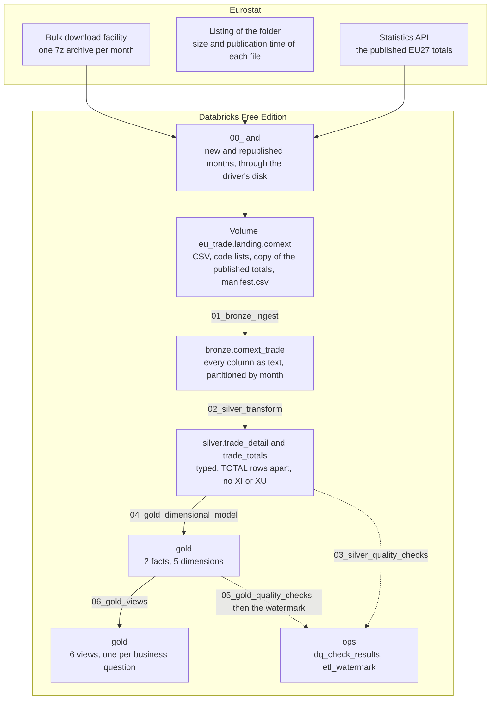
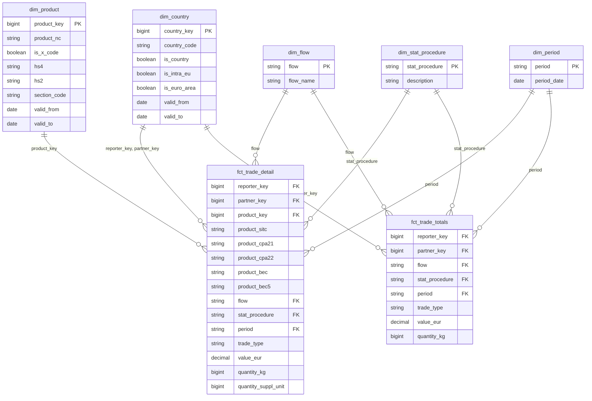

# EU Trade Lakehouse

Medallion lakehouse over Eurostat COMEXT detailed international trade data, built in PySpark on
Databricks.

**Python** · **PySpark** · **Delta Lake** · **Databricks** · **SQL**

Seven months of 2026, 35,253,450 rows, go through bronze, silver and gold written by hand in
PySpark. One Databricks Job lands each month from Eurostat and takes it to the views of five
business questions, and a watermark notices when Eurostat republishes a month under the same file
name. 25 quality checks declare the failures they expect, and a result off its expectation stops
the run.

## Business Questions

Five questions about the trade of the 27 member states, each answered by one view over the star
schema and one query in [`sql/analysis_queries.sql`](sql/analysis_queries.sql):

1. **Main partners.** Who are each reporter's main partners, and how did the ranking change over
   the months loaded?
2. **Surplus and deficit.** Which products explain each reporter's surplus or deficit?
3. **Intra-EU against extra-EU.** How does trade within the EU compare with trade outside it, by
   country and by product?
4. **Dependence.** Which flows depend most on a single partner?
5. **Value per kilogram.** Where does the value per kilogram of the same product diverge between
   partners, and what can explain it?

The last two do not come from grouping and summing. Question 4 is a supply-chain risk, and it is
asked by product heading because a dependence is invisible in a reporter's whole flow: Germany's
largest import partner holds 14.5% of its imports, while China holds 44.0% of its imports of
batteries. Question 5 looks for price anomalies, and divides sums instead of averaging ratios. The
answers for July 2026 are in [Results](#results).

## Dataset

**Eurostat COMEXT, international trade in goods, detailed data by CN8**, from the
[bulk download facility](https://ec.europa.eu/eurostat/api/dissemination/files/?dir=comext%2FCOMEXT_DATA%2FPRODUCTS):
one 7z archive per month, 45 to 48 MB, holding one comma-separated file of 18 columns, 400 to 423 MB
extracted. The SDMX API does not serve this dataset. Loaded here: the seven full months of January
to July 2026, from the publication of 2026-10-16, 4,877,993 to 5,149,512 rows a month and
35,253,450 in all. They cover 27 reporters, 246 partner codes, 9,783 eight-digit product codes and
5,468 product codes ending in X.

The data is official, and several of its properties give a wrong number without anything
failing:

| What is in the data | Measured | What the pipeline does |
|---|---|---|
| Each file carries its own totals as rows, `PRODUCT_NC = TOTAL`, next to the rows they add up | July 2026: 1,224,894.873 M EUR in the `TOTAL` rows and 1,224,894.940 in the others. A sum over the file counts every euro twice | Silver puts them in a table of their own, `trade_totals` |
| Eurostat republishes months under the same file name, with other rows | May 2026 went from 4,988,013 rows in the publication of 2026-09-15 to 4,994,361 in that of 2026-10-16, and its total by 294.2 M EUR | The watermark records the publication each file came from, not only its month |
| A partner confidential at product level moves to the codes QY and QZ in the rows by product, while the `TOTAL` row still names it | July 2026: 9,738.2 M EUR, 0.80% of the month | Rankings by partner read the totals; questions by product read the detail, and report what QY and QZ hold |
| Product codes ending in X hold confidential or estimated trade, at the level of a chapter, a heading or a subheading | July 2026: 78,498 rows, 1.56% of the detail, and 2.93% of its value | `is_x_code`, and an HS hierarchy that stops at the level the code keeps |
| A weight of 0 next to a positive value | 5.31% to 5.62% of the rows by product, every month | Kept and counted by check 06a. A value per kilogram needs a positive weight |
| The newest month of the listing arrives without most of its intra-EU trade | August 2026, as listed on 2026-10-20: 25,760,599 bytes, against 44.7 and 44.3 MB for August 2024 and 2025, with the intra-EU trade of 9 of the 27 reporters: 59,438 M EUR of intra-EU exports, against the 322,390 published | An open window stops at the month before the last one listed, and lands the newest with the next release |

Where the partner of a flow is not where the goods come from, and why ships follow their owner, is
in [Results](#results) and [Limitations](#limitations). Why the newest month comes incomplete,
from Eurostat's manual, is in
[the notes](docs/engineering-notes.md#the-newest-month-lacks-most-of-its-intra-eu-trade).
Every property of the source, with its counts, is in
[`docs/engineering-notes.md`](docs/engineering-notes.md), from Source access to Values.

## Architecture

The pipeline runs as one Job on Databricks serverless, from Eurostat to the views: its first task
lands the months of the window in a Volume, and the six notebooks after it build the layers.



The Job `eu_trade_pipeline` runs the seven tasks in the order of their numbers, one run at a time,
from the branch `main` of this repository.

Three properties of this shape are deliberate.

- **The landing is the first task.** It downloads from `ec.europa.eu` on the serverless compute of
  the Job, which reaches the internet on Free Edition, and extracts each archive on the driver's
  disk before copying its CSV into the Volume, which does not take the random writes of an
  extraction
  ([The landing goes through the driver's disk](docs/engineering-notes.md#the-landing-goes-through-the-drivers-disk)).
  A run processes what it landed itself, with no step outside the workspace.
- **Bookkeeping has a schema of its own.** `ops` holds the results of the checks and the
  watermark, so rebuilding bronze, silver or gold does not take the record of what was checked and
  processed with it.
- **The watermark is written last.** The gold checks write it, and only when every result of both
  layers matched its expectation. A run that stops leaves its months pending, and the next run
  writes them again in place.

## Tech Stack

| Layer | Tool | Why |
|---|---|---|
| Extraction | Python, `requests` and `py7zr`, in the first task of the Job | The archives are 7z, which `zipfile` cannot open. The Job installs `py7zr` in an environment of that task alone |
| Landing | Unity Catalog Volume, written through the driver's disk | Each month is downloaded and extracted on the driver and copied in one sequential write, next to a manifest of what the Volume holds |
| Processing | PySpark on Databricks serverless, environment version 6 | The notebooks run through Spark Connect, and the tests run the same logic on a local Spark |
| Storage | Delta tables managed by Unity Catalog | `replaceWhere` rewrites one month in place, the history keeps the version before, and MERGE loads the dimensions with history |
| Data quality | Checks in PySpark, results in `ops.dq_check_results` | Each check declares its expected failures, and a result off its expectation stops the run |
| Orchestration | Databricks Jobs | Seven tasks in a chain, read from the GitHub repository, one run at a time, with a monthly schedule, paused |
| Analysis | Spark SQL views and queries in `sql/` | One view per business question, one query per answer |
| Tests and CI | pytest, ruff, mypy, GitHub Actions | 253 tests, 137 of them on a local Spark with Delta, over real rows of the landed files, on every push |

**Why Spark, for 35 million rows.** The data comes as monthly files of about five million rows,
and every layer is partitioned by month: each run reads, rewrites and checks whole months, which is
the shape Spark distributes. Seven months still fit on one machine, and the logic was developed on
one ([What Is Not in This Repository](#what-is-not-in-this-repository)). Databricks adds what one
machine does not have: Unity Catalog, compute that reaches Eurostat, a Job with the history of its
runs, and a SQL warehouse over gold. A month more is a partition more, about five million rows,
and enters the window on its own.

## Pipeline Steps

| # | Step | Writes | Stops the run when |
|---|---|---|---|
| 1 | [`00_land`](notebooks/00_land.py): reads the listing, compares each month of the window with the Volume's manifest, lands the new and republished ones with a copy of the published totals, and downloads the code lists the Volume lacks | The Volume `eu_trade.landing.comext` | The window holds no month, or an archive has another size than the listing shows, or holds anything other than one `.dat` file |
| 2 | [`01_bronze_ingest`](notebooks/01_bronze_ingest.py): the pending months, every column as text, with `_ingested_at`, `_source_file` and `_batch_id` | `bronze.comext_trade` | A file's rows differ from its lines, a row carries another month, a field is null, or a file was loaded in more than one batch |
| 3 | [`02_silver_transform`](notebooks/02_silver_transform.py): typed and renamed in one `select`, the `TOTAL` rows apart, XI and XU out, the HS levels derived | `silver.trade_detail`, `silver.trade_totals` | A file's bronze rows are not its detail, its totals and the XI and XU rows left out |
| 4 | [`03_silver_quality_checks`](notebooks/03_silver_quality_checks.py): 17 checks | `ops.dq_check_results` | A result is off its expectation |
| 5 | [`04_gold_dimensional_model`](notebooks/04_gold_dimensional_model.py): the dimensions from the code lists and two seeds, the two with history by MERGE, then the facts | 2 facts and 5 dimensions in `gold` | A silver row is not exactly one fact row with every key resolved |
| 6 | [`05_gold_quality_checks`](notebooks/05_gold_quality_checks.py): 8 checks, then the watermark | `ops.dq_check_results`, `ops.etl_watermark` | A result of either layer is off its expectation |
| 7 | [`06_gold_views`](notebooks/06_gold_views.py): the six views, then the answers | 6 views in `gold` | A view loses, adds or splits the value of the fact rows it reads |

Notebooks 01 to 05 process only the pending months (see [Incremental Load](#incremental-load)),
and end without writing when there are none. The rules of each step, its counts and the cases that
fail it are in the [engineering notes](docs/engineering-notes.md).

## Data Model

Two facts, one per silver table, share five dimensions. A row by product keeps the five parallel
classifications of the source, SITC, CPA 2.1, CPA 2.2, BEC and BEC5, on the fact: an X code can take
several rows that differ only in them.



**Two facts, because the two kinds of rows name different partners.** Rankings by partner read
`fct_trade_totals`, whose `TOTAL` rows name the real partner; questions by product read
`fct_trade_detail`. Over a month of more than a trillion euros the two differ by tens of thousands:
66,547.619 EUR in July 2026, and gold check 07 measures where.

**`dim_country` and `dim_product` keep their history**, one row per version of a code. A version
starts where one of its sources starts a row, or the day after it ends one: the code lists, the EU
and euro-area zones, and two seeds written by hand. They load with a MERGE on `(code, valid_from)`, written by hand, that
updates a version whose end or attributes changed, inserts a new one, and counts one missing from
the source instead of deleting it. The keys are `xxhash64(code, valid_from)`, so a rebuilt
dimension keeps them, and a fact row joins the version that covers its month. Bulgaria shows why:

| `country_code` | `valid_from` | `valid_to` | `is_intra_eu` | `is_euro_area` |
|---|---|---|---|---|
| BG | 1976-01-01 | 2006-12-31 | false | false |
| BG | 2007-01-01 | 2025-12-31 | true | false |
| BG | 2026-01-01 | 2500-12-31 | true | true |

Bulgaria adopted the euro on 2026-01-01, and Eurostat's relation of the euro area has no row for
it: it was last published on 2025-02-24. The euro area comes from a seed instead,
[`reference/euro_area_members.csv`](reference/euro_area_members.csv), with the source of each row.
Against the relation as published, silver check 07 flags every row of Bulgaria with a value:
101,142 rows by product in the May 2026 file of 2026-09-15.

The changes of 2026 went through the MERGE of the real tables while the model was developed.
Written as they stood on 2025-12-31 and merged with today's, `dim_country` had one version
updated and one inserted, Bulgaria's, and `dim_product` 14 updated, the codes closed on
2025-12-31, and 27 inserted, opened on 2026-01-01, lithium nickel manganese cobalt oxides and
lithium iron phosphate among them. Two tests run the same MERGE over real lines of the code
lists
([Loading the versioned dimensions](docs/engineering-notes.md#loading-the-versioned-dimensions)).

Every column, with its type and where it comes from, is in
[`docs/data_dictionary.md`](docs/data_dictionary.md). Each modelling choice, with the alternatives
and their numbers, is in the [engineering notes](docs/engineering-notes.md#gold).

## Data Quality

**25 checks, 17 on silver and 8 on gold, and over the seven months every one found exactly the
failures it expects.** A check writes one row per table and file to `ops.dq_check_results`, in a
schema apart from the data: what it read, how many rows broke its rule, and what it expected, a
count or a range for a share of the rows. The notebook reads its results back and stops the run on
any result off its expectation, in either direction, so a check that starts passing stops it as
surely as one that starts failing. Every month expects the same rule, whatever the month and its
publication, so a month new to the pipeline, or republished with other counts, needs nothing
declared.

What the checks found in the full months of January to July 2026:

| Check | Rule | Found |
|---|---|---|
| Silver 06a | A weight of 0 with a positive value: counted, not dropped | 271,767 to 283,190 rows a month, 5.31% to 5.62% of the rows by product. Every month expects 5.0% to 6.0% |
| Silver 06b | A supplementary unit with a quantity of 0 and a positive value | 22,201 to 24,299 rows, 0.44% to 0.50%. Every month expects 0.40% to 0.60% |
| Silver 10 | The totals by trade type and flow, and the UK, within 0.05 M EUR of the figures Eurostat publishes, from a copy saved with the files of the same publication | 0 of the 6 figures off, in every month |
| Gold 07 | Per reporter, trade type, flow and procedure, the rows by product within 0.01 M EUR of the totals | 2 of 239 to 242 groups in every month: France's intra-EU imports and exports, the only groups beyond the tolerance ([Limitations](#limitations)) |
| The other 21 | Codes valid on the month's date, values not negative, the month of the file, every `TOTAL` row of its expected shape and none in the detail, no XI or XU row, no duplicate on the grain, trade type agreeing with EU membership, lossless casts, nulls only from a sentinel; in gold, each silver row one fact row, every key resolved to exactly one row of each dimension, values equal to silver's, unique keys, versions that do not overlap and that cover the month of each fact row | 0 |

**A check off by one row stops the run.** With the expectation of 06a moved by one row, up and then
down, the run wrote its results and stopped, naming the check, the table, the file and both counts.

The checks of the notebooks themselves come on top: bronze counts each file's lines without the
CSV parser, silver accounts for every bronze row, gold for every silver row, and the views for the
value of every fact row they read ([Pipeline Steps](#pipeline-steps)). The rule, the reasoning and
the measured result of each check are in the notes, [silver](docs/engineering-notes.md#the-checks)
and [gold](docs/engineering-notes.md#the-checks-of-gold).

## Incremental Load

**A month is pending when its file was landed from a publication the pipeline has not
processed**: new to the pipeline, or republished by Eurostat since. The month in the file name
cannot tell them apart, because Eurostat regenerates published months in place, under the same
name, with other rows and sometimes the same size. The publication time can, and two records
carry it:

| Record | Holds | Compared with |
|---|---|---|
| `manifest.csv` in the Volume | The size and publication time of each landed archive | The listing of the bulk download facility, by the landing |
| `ops.etl_watermark` | One row per file, with the publication processed | The Volume's manifest, by each notebook from 01 to 05 |

Bronze, silver and both facts replace the pending months whole, with `replaceWhere` on the month,
so a month written twice is written in place, never added. **A republished month is replaced
without asking**: the landing writes its CSV and its copy of the published figures over the old
ones, and the version before stays in the history of the Delta tables
([The Volume's manifest](docs/engineering-notes.md#the-volumes-manifest)). Its checks need nothing
declared, since every month expects the same rule.

Three runs over the full months on serverless:

| Run | Months | What happened |
|---|---|---|
| Republished | 202601 to 202606, with 202605 republished | Only 202605 pending. Bronze replaced its 4,988,013 rows with 4,994,361, the watermark changed in that month alone, and the views of the other five months stayed identical, byte for byte. May's total moved by 294.2 M EUR |
| New month | 202601 to 202607 | Only 202607 pending: 5,050,155 rows into bronze, 35,253,450 in all, and the watermark at 7 rows |
| Nothing pending | The same | Notebooks 01 to 05 ended without writing, and no table gained a version |

The Job then landed 202607 again from Eurostat, with its CSV deleted from the Volume and its row
from the watermark, and took it through every layer: its views printed the same 42 lines as the
run of the new month, byte for byte ([The Job](docs/engineering-notes.md#the-job)).

**The window is open at its end.** A run takes the months from the parameter `start_period`,
`202601` by default, to `end_period`, empty by default. Empty, the landing stops at the month
before the last one listed, since the newest month lacks most of its intra-EU trade
([Dataset](#dataset)), and lands that month with the next release, once complete. The notebooks
take their months from the Volume's manifest, which therefore never holds the incomplete one
([The window of a run](docs/engineering-notes.md#the-window-of-a-run)). A run with the defaults
over the seven months left 202608 out, found nothing pending, and printed the same 42 lines.

**The schedule is paused.** The definition of the Job runs it monthly, on the 20th at 06:00
Brussels time, after each Eurostat release: that is how it would run in production, and a month
would then enter on its own, about the 20th of the third month after it. Here a schedule would
spend the compute quota on its own, so it stays paused, and a run starts by hand.

## How to Run

Requires Python 3.12 for the deploy, the tests and lint, and a Databricks workspace for the
pipeline, where Free Edition is enough. Without an account, the tests run over real rows of the
landed files. The commands are for PowerShell on Windows, where the project was built. On Linux or
macOS the interpreter is `.venv/bin/python`, and a variable is set with `export`.

**1. Install.** On Windows with long paths disabled, the default, the install of `pyspark` fails
with `OSError: [Errno 2]` when the repository's path is longer than 116 characters: clone to a
short path, such as `C:\src`, or enable long paths. Check also that `python` is a 3.12: it and the
`py` launcher can resolve to different interpreters.

```powershell
git clone https://github.com/rdiguglielmo/eu-trade-lakehouse
cd eu-trade-lakehouse
python -m venv .venv
.venv\Scripts\python -m pip install --require-hashes -r requirements.txt
```

`requirements.txt` pins every package, dependencies included, with its hashes: those of the
landing, the Databricks SDK of the deploy, and Spark and Delta as the engine of the tests
([Environment](docs/engineering-notes.md#environment)).

**2. Prepare the workspace.** On Databricks Free Edition:

- a catalog `eu_trade`, created in Catalog Explorer: the landing creates its schema and the
  Volume, not the catalog;
- a Git credential for GitHub, so the Job can read the notebooks from the repository in the
  `git_url` of [`jobs/trade_pipeline_job.json`](jobs/trade_pipeline_job.json); here, the
  Databricks GitHub App, with access to this repository. A fork changes the `git_url`;
- a personal access token with the scope `jobs`, for the deploy, from `DATABRICKS_HOST` and
  `DATABRICKS_TOKEN` or a profile of `~/.databrickscfg`, here one of its own named `jobs`.

**3. Deploy the Job, and run it.**

```powershell
$env:DATABRICKS_CONFIG_PROFILE = 'jobs'
.venv\Scripts\python src\deploy_job.py
```

The deploy creates the Job `eu_trade_pipeline` from its definition, or replaces the settings of
the one of that name, and starts no compute. The Job starts from the Jobs page, with Run now. With
the defaults a run lands every month from 202601 to the month before the last one listed, 45 to 48
MB each to download, and builds every layer over the pending ones; Run now with different
parameters sets `start_period` and `end_period`, as `YYYYMM`, for one run. The last task prints
the answers of [`sql/analysis_queries.sql`](sql/analysis_queries.sql).

**Tests and lint.**

```powershell
.venv\Scripts\python -m pytest -m "not spark"
.venv\Scripts\python -m pytest
.venv\Scripts\ruff check .
.venv\Scripts\ruff format --check .
.venv\Scripts\python -m mypy src notebooks
```

253 tests. The 116 not marked `spark` start no JVM, and run wherever the lock is installed. The
137 marked `spark` start a local Spark with Delta, which needs a JDK 17 and `JAVA_HOME`, and on
Windows can hang at the start of its first session. The CI runs ruff, mypy and the whole suite on
every push, on Ubuntu, in 8 to 10 minutes
([Tests and lint](docs/engineering-notes.md#tests-and-lint)).

## Results

What the data says for July 2026 (202607), the latest of the seven full months loaded, January to
July 2026. Every figure comes from a query: one per business question in
[`sql/analysis_queries.sql`](sql/analysis_queries.sql), and the counts and cases behind the text in
[`sql/results_queries.sql`](sql/results_queries.sql). Each section names its queries by the first
line of their comment. Values are in million EUR and shares in percent, to one decimal.

Source: Eurostat, international trade in goods, detailed data by CN8 (Comext bulk download),
publication of 2026-10-16. Eurostat's
[copyright notice](https://ec.europa.eu/eurostat/web/main/help/copyright-notice) authorises reuse
with the source acknowledged, under the Commission Decision of 12 December 2011 (2011/833/EU); trade
declared by Austria at eight digits may not be sold. The figures here are this project's
transformation of the data, and Eurostat bears no responsibility for them. The pages cited as the
manual are those of Eurostat's *User manual on international trade in goods statistics*, 2026
edition.

### Question 1: Germany is the first partner of 13 reporters' imports and 15 reporters' exports

Germany imports first from the Netherlands, 17,621.3 M EUR or 14.5% of its imports, then China,
7.6%, and Poland, 7.3%. It exports first to the United States, 10.9%, then France, 7.4%, and the
Netherlands, 7.0%: the same three partners, in the same order, as in January.

**The ranking holds over the seven months: 113 of the 162 top-three positions keep their January
rank.** Of the other 49, 29 belong to partners that were already in the top three and changed
places, and 20 to partners new to it, 11 in imports and 9 in exports. Morocco ranked 80th among
Cyprus's export partners in January and is second in July; the British Virgin Islands, from which
Malta imported nothing in January, are second among its import partners (Partners far from a
reporter's routes, below).

*Queries: Question 1; Question 1, how the ranking changed; Question 1, the first partners.*

### Question 2: 10 of the 27 reporters are in surplus, and mineral fuels are the largest deficit of 18

Germany's surplus, +21,972.0 M EUR, comes first from vehicles (chapter 87), +9,338.4, against
mineral fuels (chapter 27), -5,435.6. Chapter 27 is the largest deficit of 18 reporters, and
vehicles of 4. Ireland's surplus comes first from pharmaceutical products (chapter 30), +4,688.6.
France has the largest deficit, -7,197.2, though aircraft (chapter 88) give it a surplus of
+2,068.3.

*Queries: Question 2; Question 2, surplus and deficit.*

### Question 3: the intra-EU share of imports runs from Slovenia's 33.4% to Luxembourg's 87.9%

Germany's is 64.6%. Cyprus sends the smallest share of its exports to the EU, 19.5%. By chapter,
over every reporter, the lowest intra-EU shares of imports are works of art (chapter 97), 12.2%,
articles of feathers and human hair (67), 22.9%, and ships (89), 28.2%; the highest is cork (45),
95.2%.

*Queries: Question 3, by country; Question 3, by product.*

### Question 4: seven headings come from, or go to, a single partner

Among the headings that hold at least 1% of a reporter's flow, seven have a single partner at
100.0% of their value: electricity imported by Malta from Italy and by Portugal from Spain, aircraft
imported by Croatia from Canada and by Luxembourg from the United States, ships imported by Malta
from Italy, Malta's exports of coal-tar oils (2707) to France, and Cyprus's exports of odoriferous
mixtures (3302) to Libya.

Germany depends most on refined petroleum from the Netherlands, 64.7%, batteries from China, 44.0%,
and gas turbines from the United States, 39.6%. Slovenia's medicaments (3004) are 38.4% of its
exports, and 67.7% of them go to Switzerland, against 71.2% to 87.8% in the six months before.

*Queries: Question 4; Processing trade, month by month.*

### Question 5: 275 of 2,749 products and flows have a dearest partner at ten times the cheapest or more

Over the products and flows with two partners of at least 10 M EUR in the month, the median gap
between the dearest and the cheapest partner is 1.85. Two patterns run through the widest gaps,
and the manual explains neither:

| Pattern | Product | Dearest, EUR/kg | Cheapest, EUR/kg | Times |
|---|---|---:|---:|---:|
| Metal content | Precious-metal ores and concentrates (26169000), imported | South Africa, 42,446.52 | Ecuador, 9.92 | 4,279.33 |
| Metal content | The same, exported | Italy, 88,243.99 | Germany, 208.49 | 423.24 |
| Active ingredients | Lactams (29337900), imported | Ireland, 27,118.63 | United States, 4.31 | 6,291.00 |
| Active ingredients | Heterocyclic compounds (29335995), imported | Switzerland, 108,009.95 | Germany, 109.10 | 990.00 |

A third, quantities that do not add up, is in Limitations.

**A gap inside one code need not be a gap in price.** Unroasted coffee (09011100) comes from 17
partners of at least 10 M EUR, from Viet Nam's 3.50 EUR per kilogram to Kenya's 6.86, 1.96 times.
The code holds every coffee neither roasted nor decaffeinated, so its partners can be selling
different coffees.

*Queries: Question 5; Question 5, the spread of the gaps; Value per kilogram within one code.*

### Processing trade: 98.5% of Slovenia's imports from Switzerland are for inward processing

Switzerland is Slovenia's first partner in both flows: 2,216.9 M EUR of imports, 23.7%, and 2,170.5
of exports, 27.5%. 98.5% of those imports and 97.1% of those exports run under statistical
procedure 2, inward processing. Organic chemicals (chapter 29), 1,194.6 M EUR, and pharmaceutical
products (30), 988.1, come in; pharmaceutical products, 2,106.5, go out. Goods that cross a border
to be processed, and the goods that come back, are recorded at their full value even when their
ownership does not change (manual, pp. 25-26, 32 and 34-35): the figures measure the whole value
of the goods, not the value Slovenia adds to them.

*Queries: Question 1; Processing trade: Slovenia's trade with Switzerland by statistical
procedure; Processing trade: Slovenia's trade with Switzerland by chapter and procedure.*

### Partners far from a reporter's routes

**The British Virgin Islands are Malta's second import partner, 155.0 M EUR or 14.7% of its
imports, and all of it is yachts (heading 8903).** They ranked 30th the month before. Yachts are
also Malta's largest import from Italy, 51.8 M EUR, and from France, 31.2. In the manual a
vessel's partner follows its owner, not its route: a vessel is traded in the month its economic
ownership changes, under statistical procedure 9 (pp. 35 and 87-90). These imports are under
procedure 1, so the data does not show a change of ownership.

**Cyprus's three first export partners are Lebanon, Morocco and Libya, and 84.0% to 99.8% of
what each takes is refined petroleum exported after inward processing.** They take 103.1, 100.8
and 91.6 M EUR, 15.5%, 15.2% and 13.8% of Cypriot exports, and heading 2710 under statistical
procedure 2 accounts for 101.0, 100.6 and 77.0 of it. The data does not say why these partners.

*Queries: Question 1; Partners far from a reporter's routes.*

## What Is Not in This Repository

- **A dashboard.** The answers are in [Results](#results), each with the query behind it, and the
  views in `gold` keep every heading and every partner for a report that wants other floors. The
  Power BI work is in the projects before this one,
  [rdiguglielmo/sec-edgar-financial-pipeline](https://github.com/rdiguglielmo/sec-edgar-financial-pipeline)
  and
  [rdiguglielmo/us-restaurant-financials-analysis](https://github.com/rdiguglielmo/us-restaurant-financials-analysis).
- **A way to run the pipeline locally.** The transformation logic was developed and verified on a
  local Spark 4.2 with Delta 4.4, first over the partial files of each month, to spend no compute
  quota of Free Edition. That setup is not part of this repository: here a local Spark is only the
  engine of the tests.
- **The data, and an export of gold.** The landed files live in the Volume, where the first task
  of the Job puts them: a month is 45 to 48 MB to download and 400 to 423 MB extracted. The Job
  rebuilds every table from them, and [Results](#results) gives every number with the query behind
  it; the detail fact alone holds 35,164,358 rows.
- **The Databricks workspace.** A Free Edition workspace can be deleted after a long inactivity.
  Everything it holds is rebuilt from this repository: the Job by `src/deploy_job.py`, the Volume
  by its landing task, and the tables by its other tasks.
- **The exploratory notebooks** that measured the source before the layers were designed. Every
  measurement a decision rests on is in [`docs/engineering-notes.md`](docs/engineering-notes.md).
- **dbt.** The medallion layers written by hand in PySpark are what this project shows. The SEC
  EDGAR pipeline builds its warehouse with dbt.

## Limitations

What the project cannot answer, each with the number that bounds it. The figures are those of
July 2026 unless a line says otherwise.

- **Where the goods were made.** The partner of an intra-EU import is the member state the goods
  were shipped from; that of an extra-EU import, the country of origin (manual, pp. 30 and 60).
  Goods released for free circulation in Rotterdam reach Germany as Dutch intra-EU exports (pp.
  36-37), so the Netherlands, Germany's first import partner with 14.5%, can be shipping goods made
  elsewhere, and the data cannot tell how much. The manual names the same effect for the ports of
  Belgium and the airports of Luxembourg and Hungary. Germany's refined petroleum from the
  Netherlands, 64.7% in question 4, can be Dutch refining or transit.
- **Who the partner is, for part of the trade.** Trade whose partner is confidential or not
  specified sits under Q codes, which count in a flow's total but name no partner, so a share in
  question 4 is a lower bound. In its answer the Q codes hold up to 35.7% of a heading, the
  Netherlands' exports of yachts (8903), whose largest named partner, the United States, holds
  63.2%.
- **A value per kilogram where the value is right and the weight is not.** A reporter may publish
  a value and keep its quantity confidential; the net mass of intra-EU trade in a code with a
  supplementary unit may be estimated; a weight below 0.5 kg reads 0; and the manual places the
  most common errors at the most detailed level, ratios of value to volume among them (pp. 33-34,
  40-41 and 48-49). Machining centres (84571090) imported from Germany at 0.03 EUR per kilogram,
  against 60.97 from Switzerland, are a ratio these mechanisms leave open, and the manual does not
  say which applies.
- **Why the detail exceeds the totals.** In each of the seven months the rows by product add up to
  61,919 to 68,009 EUR more than the `TOTAL` rows, and only France's intra-EU trade passes the
  tolerance of gold check 07, 0.01 M EUR, in both flows and every month: imports 12,381 to 15,452
  EUR above the totals, exports 24,144 to 26,751. No documented cause explains it. The manual does
  not mention rounding, and the one exception it describes, confidential trade kept in a country's
  total but allocated to no chapter (p. 42), would put the totals above the detail.
- **Seasonality, and change over a year.** Seven months of 2026 are loaded, January to July. The
  ranking change of question 1 runs over those months only, and no figure compares a month with the
  same month a year before.
- **Figures that change after publication.** Every figure is from the publication of 2026-10-16,
  and Eurostat republishes months under the same file name: the total for May 2026 moved by
  294.2 M EUR between the publications of 2026-09-15 and 2026-10-16
  ([The incremental run](docs/engineering-notes.md#the-incremental-run)).

*Queries: Question 1; Question 4; Question 5; Detail against totals, in every month loaded; Detail
against totals: the groups beyond the tolerance.*

**The platform**, Databricks Free Edition, as observed in this workspace:

- Serverless compute only, and one SQL warehouse, of size 2X-Small: creating a second is disabled.
- A compute quota that Databricks does not publish. The most spent in one day was 11.06 DBU,
  measured in `system.billing.usage`, and compute stayed on.
- The notebooks run there through Spark Connect, on serverless environment version 6, and the
  tests run on classic Spark. What runs differently, which the tests cannot see, is in the notes,
  [Silver, gold and the views on serverless](docs/engineering-notes.md#silver-gold-and-the-views-on-serverless).

Read in the documentation and not observed: exceeding the quota shuts compute down for the rest of
the day; at most 5 job tasks run at once, which a chain run one task at a time never reaches; one
pipeline of each type; an account inactive for long can be deleted; no commercial use. The
documentation also restricts outbound internet access, yet the landing task of the Job
downloads from `ec.europa.eu` on serverless.

---

Part of a four-project data portfolio: [github.com/rdiguglielmo](https://github.com/rdiguglielmo)

Licensed under the [MIT License](LICENSE). The data is Eurostat's, reused under its copyright
notice (see [Results](#results)).
