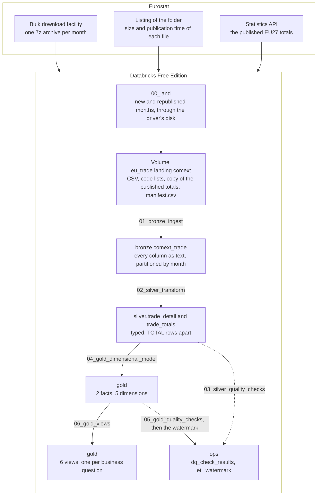
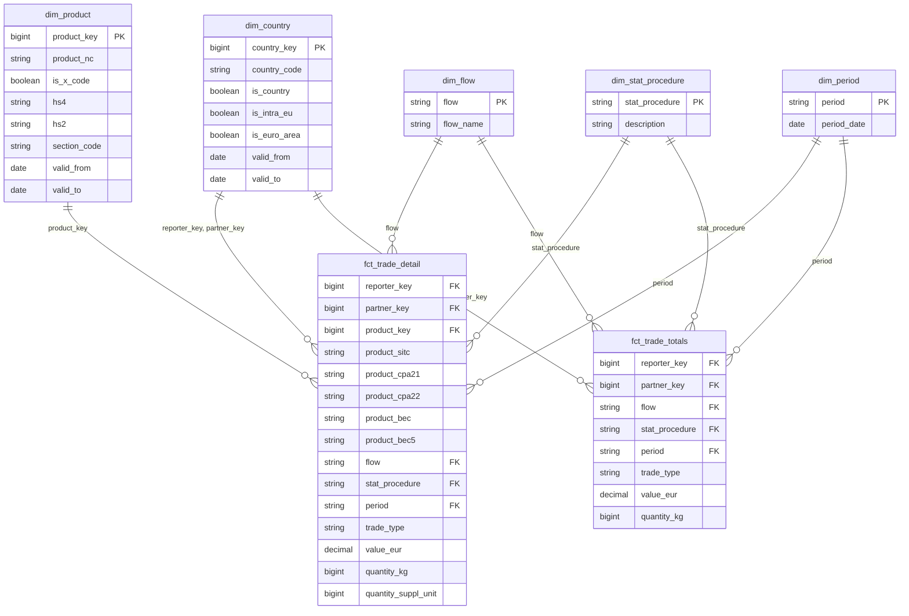

# EU Trade Lakehouse

[](https://github.com/rdiguglielmo/eu-trade-lakehouse/actions/workflows/ci.yml)
**Python** · **PySpark** · **Delta Lake** · **Databricks** · **SQL**

Medallion lakehouse over Eurostat COMEXT detailed trade data, built in PySpark on Databricks:
seven months of 2026, 35 million rows, through bronze, silver and gold written by hand. One Job
lands each month from Eurostat and takes it to the views of five business questions; a watermark
notices when Eurostat republishes a month, and 20 quality checks declare the failures they expect.

## Contents

- [What This Project Shows](#what-this-project-shows)
- [Business Questions](#business-questions)
- [Dataset](#dataset)
- [Architecture](#architecture)
- [Tech Stack](#tech-stack)
- [Repository Layout](#repository-layout)
- [Pipeline Steps](#pipeline-steps)
- [Data Model](#data-model)
- [Data Quality](#data-quality)
- [Incremental Load](#incremental-load)
- [How to Run](#how-to-run)
- [Results](#results)
- [What Is Not in This Repository](#what-is-not-in-this-repository)
- [Limitations](#limitations)

## What This Project Shows

| Technique | How | Where to look |
|---|---|---|
| Medallion layers written by hand | Bronze a faithful copy as text, silver typed with the `TOTAL` rows apart, gold a star schema of 2 facts and 5 dimensions, in PySpark and without dbt | [`src/`](src/), and the notes from [Bronze](docs/engineering-notes.md#bronze) to [Gold](docs/engineering-notes.md#gold) |
| Incremental load by publication | A watermark records, per file, the Eurostat publication processed: a month new or republished under the same name is pending, and `replaceWhere` rewrites it in place | [`src/watermark.py`](src/watermark.py), [Incremental Load](#incremental-load) |
| Slowly changing dimensions, type 2 | `dim_country` and `dim_product` keep one row per version of a code, loaded by a MERGE written by hand, and a fact row joins the version valid in its month | [`src/gold.py`](src/gold.py), [SCD type 2](docs/engineering-notes.md#dimensions-with-history-scd-type-2) |
| Data quality with expected failures | 20 checks declare the failures they expect and write their results to `ops`; a result off its expectation, in either direction, stops the run | [`src/silver_checks.py`](src/silver_checks.py), [`src/gold_checks.py`](src/gold_checks.py), [Quality checks](docs/engineering-notes.md#quality-checks) |
| Reconciliation with published figures | Each month's totals within 0.05 M EUR of the figures Eurostat publishes, from a copy saved with the files of the same publication | [The source](docs/engineering-notes.md#the-source) |
| Orchestration from the repository | One Databricks Job of seven tasks, from Eurostat to the views, read from the branch `main` and created from a JSON definition | [`jobs/trade_pipeline_job.json`](jobs/trade_pipeline_job.json), [The Job](docs/engineering-notes.md#the-job) |
| CI | ruff, mypy and 245 tests, 130 of them on a local Spark with Delta over real rows of the landed files, on every push | [`ci.yml`](.github/workflows/ci.yml), [Tests and lint](docs/development.md#tests-and-lint) |

<p align="right"><a href="#eu-trade-lakehouse">Back to top</a></p>

## Business Questions

Five questions about the trade of the 27 member states, each answered by one view over the star
schema and one query in [`sql/analysis_queries.sql`](sql/analysis_queries.sql):

1. **Main partners.** Who are each reporter's main partners, and how did the ranking change?
2. **Surplus and deficit.** Which products explain each reporter's surplus or deficit?
3. **Intra-EU against extra-EU.** How does trade within the EU compare with trade outside it?
4. **Dependence.** Which flows depend most on a single partner?
5. **Value per kilogram.** Where does the value per kilogram of the same product diverge?

Question 4 is asked by product heading: Germany's largest import partner holds 14.5% of its
imports, while China holds 44.0% of its imports of batteries. Question 5 divides sums instead of
averaging ratios. The answers for July 2026 are in [Results](#results).

<p align="right"><a href="#eu-trade-lakehouse">Back to top</a></p>

## Dataset

**Eurostat COMEXT, international trade in goods, detailed data by CN8**, from the
[bulk download facility](https://ec.europa.eu/eurostat/api/dissemination/files/?dir=comext%2FCOMEXT_DATA%2FPRODUCTS):
one 7z archive per month, 45 to 48 MB, holding one CSV of 18 columns, 400 to 423 MB extracted.
Loaded here: January to July 2026, from the publication of 2026-10-16, 4,877,993 to 5,149,512 rows
a month. Several properties of the data give a wrong number without anything failing:

| What is in the data | Measured | What the pipeline does |
|---|---|---|
| Each file carries its own totals as rows, `PRODUCT_NC = TOTAL`, next to the rows they add up | July 2026: 1,224,894.873 M EUR in the `TOTAL` rows and 1,224,894.940 in the others. A sum over the file counts every euro twice | Silver puts them in a table of their own, `trade_totals` |
| Eurostat republishes months under the same file name, with other rows | May 2026 went from 4,988,013 rows in the publication of 2026-09-15 to 4,994,361 in that of 2026-10-16, and its total by 294.2 M EUR | The watermark records the publication each file came from, not only its month |
| A partner confidential at product level moves to the codes QY and QZ in the rows by product, while the `TOTAL` row still names it | July 2026: 9,738.2 M EUR, 0.80% of the month | Rankings by partner read the totals; questions by product read the detail |
| The newest month of the listing arrives without most of its intra-EU trade | August 2026, as listed on 2026-10-20: the intra-EU trade of 9 of the 27 reporters, 59,438 M EUR of intra-EU exports against the 322,390 published | An open window stops at the month before the last one listed |

Every property of the source, with its counts and the pages of Eurostat's manual, is in the notes,
from [The source](docs/engineering-notes.md#the-source) to [Silver](docs/engineering-notes.md#silver).

<p align="right"><a href="#eu-trade-lakehouse">Back to top</a></p>

## Architecture

One Job on Databricks serverless: its first task lands the months in a Volume, and six notebooks
build the layers.



- **The landing is the first task.** It downloads from `ec.europa.eu` on serverless and extracts
  each archive on the driver's disk ([Landing](docs/engineering-notes.md#landing-and-the-manifest)).
- **Bookkeeping has its own schema.** `ops` keeps check results and the watermark through a rebuild.
- **The watermark is written last**, only when every check of both layers matched its expectation:
  a run that stops leaves its months pending.

<p align="right"><a href="#eu-trade-lakehouse">Back to top</a></p>

## Tech Stack

| Layer | Tool | Why |
|---|---|---|
| Extraction | Python, `requests` and `py7zr`, in the first task of the Job | The archives are 7z, which `zipfile` cannot open. The Job installs `py7zr` in an environment of that task alone |
| Landing | Unity Catalog Volume, written through the driver's disk | Each month is downloaded and extracted on the driver and copied in one sequential write, next to a manifest of what the Volume holds |
| Processing | PySpark on Databricks serverless, environment version 6 | The notebooks run through Spark Connect, and the tests run the same logic on a local Spark |
| Storage | Delta tables managed by Unity Catalog | `replaceWhere` rewrites one month in place, time travel reads the version before for about 7 days, and MERGE loads the dimensions with history |
| Orchestration | Databricks Jobs | Seven tasks in a chain, read from the GitHub repository, one run at a time, with a monthly schedule, paused |
| Analysis | Spark SQL views and queries in `sql/` | One view per business question, one query per answer |

**Why Spark, for 35 million rows.** The data comes as monthly files of about five million rows, and
every run reads, rewrites and checks whole months, the shape Spark distributes. Seven months fit on
one machine; a month more is a partition more, and enters the window on its own.

<p align="right"><a href="#eu-trade-lakehouse">Back to top</a></p>

## Repository Layout

```text
.
├── .github/workflows/ci.yml       # ruff, mypy and the whole test suite on every push to main
├── docs/
│   ├── engineering-notes.md       # how each layer works, its rules and their numbers
│   ├── development.md             # install, deploy, what runs differently on serverless, tests
│   └── data_dictionary.md         # every table and column, and the code lists
├── jobs/trade_pipeline_job.json   # the Job: seven tasks, two parameters, a paused schedule
├── notebooks/                     # 00_land to 06_gold_views, one per task (Pipeline Steps)
├── reference/
│   ├── euro_area_members.csv      # seed: when each member joined the euro area, and the source
│   └── partner_special_codes.csv  # seed: the 10 Q codes, partners that are not a country
├── sql/
│   ├── gold_views.sql             # the six views of the business questions
│   ├── analysis_queries.sql       # one query per question, printed by the last task
│   └── results_queries.sql        # the counts and cases behind Results, run by no task
├── src/
│   ├── config.py                  # constants: source URLs, catalog names, the expected header
│   ├── land.py                    # lands the months of the window and the code lists
│   ├── manifest.py                # manifest.csv: the publication of each landed archive
│   ├── watermark.py               # which months are pending, against ops.etl_watermark
│   ├── bronze.py                  # reads a landed file, every column as text
│   ├── silver.py                  # the two typed silver tables
│   ├── silver_checks.py           # the 13 silver checks and the failures each one expects
│   ├── gold.py                    # the facts, the dimensions and the MERGE of the versions
│   ├── gold_checks.py             # the 7 gold checks and the failures each one expects
│   ├── gold_views.py              # creates the views from sql/gold_views.sql
│   └── deploy_job.py              # creates the Job from its definition, or replaces it
├── tests/                         # 245 tests, 130 of them on a local Spark with Delta
├── .gitattributes                 # LF line endings in every text file; 7z archives as binary
├── .gitignore                     # the virtual environment, secrets, Spark and tool caches
├── LICENSE                        # MIT
├── pyproject.toml                 # the settings of pytest and ruff; not a package
├── requirements.in                # the direct dependencies, and the range each one may move in
└── requirements.txt               # the lock compiled from it: every package at one version
```

<p align="right"><a href="#eu-trade-lakehouse">Back to top</a></p>

## Pipeline Steps

| # | Step | Writes | Stops the run when |
|---|---|---|---|
| 1 | [`00_land`](notebooks/00_land.py): reads the listing, compares each month of the window with the Volume's manifest, lands the new and republished ones with a copy of the published totals, and downloads every code list again | The Volume `eu_trade.landing.comext` | The window holds no month, or an archive has another size than the listing shows, or holds anything other than one `.dat` file |
| 2 | [`01_bronze_ingest`](notebooks/01_bronze_ingest.py): the pending months, every column as text, with `_ingested_at`, `_source_file` and `_batch_id` | `bronze.comext_trade` | A file's rows differ from its lines, a row carries another month, a field is null, or a file was loaded in more than one batch |
| 3 | [`02_silver_transform`](notebooks/02_silver_transform.py): typed and renamed in one `select`, the `TOTAL` rows apart, the HS levels derived | `silver.trade_detail`, `silver.trade_totals` | A file's bronze rows are not its detail and its totals |
| 4 | [`03_silver_quality_checks`](notebooks/03_silver_quality_checks.py): 13 checks | `ops.dq_check_results` | A result is off its expectation |
| 5 | [`04_gold_dimensional_model`](notebooks/04_gold_dimensional_model.py): the dimensions from the code lists and two seeds, the two with history by MERGE, then the facts | 2 facts and 5 dimensions in `gold` | A silver row is not exactly one fact row with every key resolved |
| 6 | [`05_gold_quality_checks`](notebooks/05_gold_quality_checks.py): 7 checks, then the watermark | `ops.dq_check_results`, `ops.etl_watermark` | A result of either layer is off its expectation |
| 7 | [`06_gold_views`](notebooks/06_gold_views.py): the six views, then the answers | 6 views in `gold` | A view loses, adds or splits the value of the fact rows it reads |

Notebooks 01 to 05 process only the pending months, and end without writing when there are none.
The cases that fail each step are in the [engineering notes](docs/engineering-notes.md).

<p align="right"><a href="#eu-trade-lakehouse">Back to top</a></p>

## Data Model

Two facts, one per silver table, share five dimensions.



**Two facts, because the two kinds of rows name different partners.** Rankings by partner read
`fct_trade_totals`, whose `TOTAL` rows name the real partner; questions by product read
`fct_trade_detail`. In July 2026 they differ by 66,547.619 EUR, and gold check 07 measures where.

**`dim_country` and `dim_product` keep their history, as SCD type 2**: one row per version of a
code, 390 and 30,985, loaded by a MERGE on `(code, valid_from)` written by hand. Bulgaria's trade of
July 2026 joins its euro-area version, and its trade of 2025 does not
([Dimensions with history (SCD type 2)](docs/engineering-notes.md#dimensions-with-history-scd-type-2)).
Every column is in [`docs/data_dictionary.md`](docs/data_dictionary.md).

<p align="right"><a href="#eu-trade-lakehouse">Back to top</a></p>

## Data Quality

**20 checks, 13 on silver and 7 on gold, and over the seven months every one found exactly the
failures it expects.** Each writes one row per table and file to `ops.dq_check_results`: what it
read, how many rows broke its rule, and what it expected, a count or a range for a share. A result
off its expectation, in either direction, stops the run, and every month expects the same rule.

| Check | Rule | Found |
|---|---|---|
| Silver 06a | A weight of 0 with a positive value: counted, not dropped | 271,767 to 283,190 rows a month, 5.31% to 5.62% of the rows by product. Every month expects 5.0% to 6.0% |
| Silver 10 | The totals by trade type and flow, and the UK, within 0.05 M EUR of the figures Eurostat publishes, from a copy saved with the files of the same publication | 0 of the 6 figures off, in every month |
| Gold 07 | Per reporter, trade type, flow and procedure, the rows by product within 0.01 M EUR of the totals | 2 of 239 to 242 groups in every month: France's intra-EU imports and exports, the only groups beyond the tolerance ([Limitations](#limitations)) |
| The other 17 | Codes valid on the month's date, values not negative, the month of the file, every `TOTAL` row of its expected shape, no duplicate on the grain, trade type agreeing with EU membership, lossless casts, nulls only from a sentinel; in gold, each silver row one fact row, every key resolved to exactly one row of each dimension, values equal to silver's, unique keys, versions that do not overlap and that cover the month of each fact row | 0 |

**A check off by one row stops the run.** With the expectation of 06a moved by one row, up and then
down, the run wrote its results and stopped, naming the check, the table, the file and both counts
([Quality checks](docs/engineering-notes.md#quality-checks)).

<p align="right"><a href="#eu-trade-lakehouse">Back to top</a></p>

## Incremental Load

**A month is pending when its file was landed from a publication the pipeline has not
processed**: new, or republished by Eurostat under the same name. The landing task writes
`manifest.csv` in the Volume ([`src/land.py`](src/land.py)), one row per landed archive with the
size and publication time of Eurostat's listing; the gold checks write `ops.etl_watermark`, one row
per file processed; notebooks 01 to 05 compare the two ([`src/watermark.py`](src/watermark.py)).
The rows behind two runs on serverless:

| Month | `manifest.csv` | `ops.etl_watermark` at first | Run over 202601 to 202606 | Run over 202601 to 202607 |
|---|---|---|---|---|
| 202605 | 46,148,464 bytes, `2026-10-16T10:00:08` | 46,127,843 bytes, `2026-09-15T09:38:30` | Pending: republished. Bronze replaced its 4,988,013 rows with 4,994,361 | Not pending |
| 202606 | 47,304,745 bytes, `2026-10-16T10:00:09` | The same | Not pending | Not pending |
| 202607 | 46,802,030 bytes, `2026-10-16T10:00:09` | No row | Outside the window | Pending: new. 5,050,155 rows into bronze |

Each run took the manifest's row into the watermark for the month it processed, and wrote no other
month. A pending month is replaced whole, with `replaceWhere`, and the publication before can be
read by time travel for about 7 days, until the `VACUUM` of predictive optimization removes its
files ([The incremental run](docs/engineering-notes.md#the-incremental-run)).

**The window is open at its end.** A run takes the months from `start_period`, `202601` by default,
to `end_period`, empty by default: the landing then stops at the month before the last one listed,
which lacks most of its intra-EU trade ([Dataset](#dataset)), and lands it with the next release.

**The schedule is paused.** The Job runs monthly, on the 20th at 06:00 Brussels time, as it would
in production; here a schedule would spend the compute quota on its own, so a run starts by hand.

<p align="right"><a href="#eu-trade-lakehouse">Back to top</a></p>

## How to Run

Requires Python 3.12 for the deploy and the tests, and a Databricks workspace, where Free Edition
is enough; the tests need no account. The commands are for PowerShell on Windows; on Linux or
macOS the interpreter is `.venv/bin/python`.

**1. Install.** Clone to a short path, such as `C:\src`: with Windows long paths disabled, the
`pyspark` install fails beyond 116 characters. Check that `python`, not only the `py` launcher,
resolves to a 3.12.

```powershell
git clone https://github.com/rdiguglielmo/eu-trade-lakehouse
cd eu-trade-lakehouse
python -m venv .venv
.venv\Scripts\python -m pip install -r requirements.txt
```

**2. Prepare the workspace.** On Databricks Free Edition: a catalog `eu_trade`, created in Catalog
Explorer; a Git credential for GitHub, so the Job reads the notebooks from the `git_url` of
[`jobs/trade_pipeline_job.json`](jobs/trade_pipeline_job.json); and a personal access token with
the scope `jobs`, from `DATABRICKS_HOST` and `DATABRICKS_TOKEN` or a profile of `~/.databrickscfg`.

**3. Deploy the Job once, from a terminal; after it, everything runs in Databricks.**

```powershell
$env:DATABRICKS_CONFIG_PROFILE = 'jobs'
.venv\Scripts\python src\deploy_job.py
```

The deploy creates the Job `eu_trade_pipeline`, or replaces its settings, and starts no compute
([Deploying the Job](docs/development.md#deploying-the-job)). Run now, on the Jobs page, lands every
month from 202601 to the month before the last one listed and builds every layer; `start_period`
and `end_period`, as `YYYYMM`, change the window for one run.

**Tests and lint.**

```powershell
.venv\Scripts\python -m pytest -m "not spark"
.venv\Scripts\python -m pytest
.venv\Scripts\ruff check .
.venv\Scripts\ruff format --check .
.venv\Scripts\python -m mypy src notebooks
```

The 130 tests marked `spark` need a JDK 17 and `JAVA_HOME`; the other 115 start no JVM. The CI runs
all 245 on every push, on Ubuntu, in 7 to 11 minutes ([Tests and lint](docs/development.md#tests-and-lint)).

<p align="right"><a href="#eu-trade-lakehouse">Back to top</a></p>

## Results

What the data says for July 2026 (202607), the latest of the seven months loaded. Every figure
comes from a query, linked below each section. Values are in million EUR and shares in percent.

Source: Eurostat, international trade in goods, detailed data by CN8 (Comext bulk download),
publication of 2026-10-16. Eurostat's
[copyright notice](https://ec.europa.eu/eurostat/web/main/help/copyright-notice) authorises reuse
with the source acknowledged, under the Commission Decision of 12 December 2011 (2011/833/EU); trade
declared by Austria at eight digits may not be sold. The figures here are this project's
transformation of the data, and Eurostat bears no responsibility for them. The pages cited as the
manual are those of Eurostat's *User manual on international trade in goods statistics*, 2026
edition.

### Question 1: Germany is the first partner of 13 reporters' imports and 15 reporters' exports

Germany imports first from the Netherlands, 17,621.3 M EUR or 14.5% of its imports, then China,
7.6%, and Poland, 7.3%; it exports first to the United States, 10.9%, then France, 7.4%, and the
Netherlands, 7.0%: the same three, in the same order, as in January. Over the seven months, 113 of
the 162 top-three positions keep their January rank, and 20 go to partners new to the top three.

Queries: [the answer](sql/analysis_queries.sql#L5-L35) · [how the ranking changed](sql/results_queries.sql#L7-L39) · [the first partners](sql/results_queries.sql#L41-L52)

### Question 2: 10 of the 27 reporters are in surplus, and mineral fuels are the largest deficit of 18

Germany's surplus, +21,972.0 M EUR, comes first from vehicles (chapter 87), +9,338.4, against
mineral fuels (chapter 27), -5,435.6. Ireland's comes first from pharmaceutical products (chapter
30), +4,688.6. France has the largest deficit, -7,197.2, though aircraft (chapter 88) give it a
surplus of +2,068.3.

Queries: [the answer](sql/analysis_queries.sql#L37-L72) · [surplus and deficit](sql/results_queries.sql#L54-L86)

### Question 3: the intra-EU share of imports runs from Slovenia's 33.4% to Luxembourg's 87.9%

Germany's is 64.6%, and Cyprus sends the smallest share of its exports to the EU, 19.5%. By
chapter, over every reporter, the lowest intra-EU shares of imports are works of art (chapter 97),
12.2%, and ships (89), 28.2%; the highest is cork (45), 95.2%.

Queries: [by country](sql/analysis_queries.sql#L74-L85) · [by product](sql/analysis_queries.sql#L87-L108)

### Question 4: seven headings come from, or go to, a single partner

Among the headings that hold at least 1% of a reporter's flow, seven have a single partner at
100.0% of their value, electricity imported by Malta from Italy among them. Germany depends most
on refined petroleum from the Netherlands, 64.7%, batteries from China, 44.0%, and gas turbines
from the United States, 39.6%. Slovenia's medicaments (3004) are 38.4% of its exports, and 67.7%
of them go to Switzerland, against 71.2% to 87.8% in the six months before.

Queries: [the answer](sql/analysis_queries.sql#L110-L145) · [Slovenia's medicaments, month by month](sql/results_queries.sql#L251-L264)

### Question 5: 275 of 2,749 products and flows have a dearest partner at ten times the cheapest or more

Over the products and flows with two partners of at least 10 M EUR in the month, the median gap
between the dearest and the cheapest partner is 1.85. Two patterns run through the widest gaps,
and the manual explains neither:

| Pattern | Product | Dearest, EUR/kg | Cheapest, EUR/kg | Times |
|---|---|---:|---:|---:|
| Metal content | Precious-metal ores and concentrates (26169000), imported | South Africa, 42,446.52 | Ecuador, 9.92 | 4,279.33 |
| Metal content | The same, exported | Italy, 88,243.99 | Germany, 208.49 | 423.24 |
| Active ingredients | Lactams (29337900), imported | Ireland, 27,118.63 | United States, 4.31 | 6,291.00 |
| Active ingredients | Heterocyclic compounds (29335995), imported | Switzerland, 108,009.95 | Germany, 109.10 | 990.00 |

**A gap inside one code need not be a gap in price.** Unroasted coffee (09011100) runs from Viet
Nam's 3.50 EUR per kilogram to Kenya's 6.86, and the code holds every coffee neither roasted nor
decaffeinated. A third pattern is in [Limitations](#limitations).

Queries: [the answer](sql/analysis_queries.sql#L147-L193) · [the spread of the gaps](sql/results_queries.sql#L88-L112) · [coffee within one code](sql/results_queries.sql#L266-L278)

### Processing trade: 98.5% of Slovenia's imports from Switzerland are for inward processing

Switzerland is Slovenia's first partner in both flows: 2,216.9 M EUR of imports, 23.7%, and 2,170.5
of exports, 27.5%, and 98.5% and 97.1% of them run under statistical procedure 2. They are recorded
at the full value of the goods, even when their ownership does not change (manual, pp. 25-26, 32
and 34-35), not at the value Slovenia adds to them.

Queries: [by procedure](sql/results_queries.sql#L114-L133) · [by chapter and procedure](sql/results_queries.sql#L135-L173)

### Partners far from a reporter's routes

**The British Virgin Islands are Malta's second import partner, 155.0 M EUR or 14.7% of its
imports, all of it yachts (heading 8903)**, after ranking 30th the month before. In the manual a
vessel's partner follows its owner, and a vessel is traded under statistical procedure 9 (pp. 35
and 87-90); these imports are under procedure 1.

**Cyprus's three first export partners are Lebanon, Morocco and Libya, 15.5%, 15.2% and 13.8% of
its exports, and 84.0% to 99.8% of what each takes is refined petroleum (heading 2710) exported
after inward processing.** The data does not say why these partners.

Queries: [both cases, by heading and procedure](sql/results_queries.sql#L175-L249)

<p align="right"><a href="#eu-trade-lakehouse">Back to top</a></p>

## What Is Not in This Repository

- **A dashboard.** The answers are in [Results](#results), each with its query. The Power BI work
  is in [rdiguglielmo/sec-edgar-financial-pipeline](https://github.com/rdiguglielmo/sec-edgar-financial-pipeline)
  and [rdiguglielmo/us-restaurant-financials-analysis](https://github.com/rdiguglielmo/us-restaurant-financials-analysis).
- **A way to run the pipeline locally.** The logic was developed on a local Spark 4.2 with Delta
  4.4, to spend no compute quota; here a local Spark is only the engine of the tests.
- **The data, and an export of gold.** The Job lands the files in the Volume and rebuilds every
  table from them; the detail fact alone holds 35,164,358 rows.
- **The Databricks workspace.** A Free Edition workspace can be deleted after a long inactivity;
  the Job, the Volume and every table are rebuilt from this repository.
- **The exploratory notebooks** that measured the source: every measurement a decision rests on is
  in the [engineering notes](docs/engineering-notes.md).
- **dbt.** The medallion layers written by hand in PySpark are what this project shows. The SEC
  EDGAR pipeline builds its warehouse with dbt.

<p align="right"><a href="#eu-trade-lakehouse">Back to top</a></p>

## Limitations

What the project cannot answer, with the number that bounds it, for July 2026 unless stated.

- **Where the goods were made.** The partner of an intra-EU import is the member state the goods
  were shipped from (manual, pp. 30 and 60). Goods released for free circulation in Rotterdam reach
  Germany as Dutch exports (pp. 36-37): the Netherlands, Germany's first import partner with 14.5%,
  can be shipping goods made elsewhere.
- **Who the partner is, for part of the trade.** Q codes count in a flow's total but name no
  partner, so a share in question 4 is a lower bound: they hold up to 35.7% of a heading, the
  Netherlands' exports of yachts (8903).
- **A value per kilogram where the value is right and the weight is not.** A quantity can be
  confidential or estimated, and a weight below 0.5 kg reads 0 (pp. 33-34, 40-41 and 48-49).
  Machining centres (84571090) imported from Germany at 0.03 EUR per kilogram, against 60.97 from
  Switzerland, are a ratio these leave open, and the manual does not say which applies.
- **Why the detail exceeds the totals.** In each month the rows by product add up to 61,919 to
  68,009 EUR more than the `TOTAL` rows, and only France's intra-EU trade passes the tolerance of
  gold check 07, 0.01 M EUR, in both flows and every month. No documented cause explains it.
- **Seasonality, and change over a year.** Seven months of 2026 are loaded, and no figure compares
  a month with the same month a year before.
- **Figures that change after publication.** The total for May 2026 moved by 294.2 M EUR between
  two publications ([The incremental run](docs/engineering-notes.md#the-incremental-run)).

Queries: [detail against totals](sql/results_queries.sql#L280-L309) · [the groups beyond the tolerance](sql/results_queries.sql#L311-L344)

**The platform**, Databricks Free Edition: serverless only, one SQL warehouse, and an unpublished
quota, with 11.06 DBU the most spent in one day ([serverless](docs/development.md#databricks-serverless)).

<p align="right"><a href="#eu-trade-lakehouse">Back to top</a></p>

---

Part of a four-project data portfolio: [github.com/rdiguglielmo](https://github.com/rdiguglielmo)

Licensed under the [MIT License](LICENSE). The data is Eurostat's, reused under its copyright
notice (see [Results](#results)).
